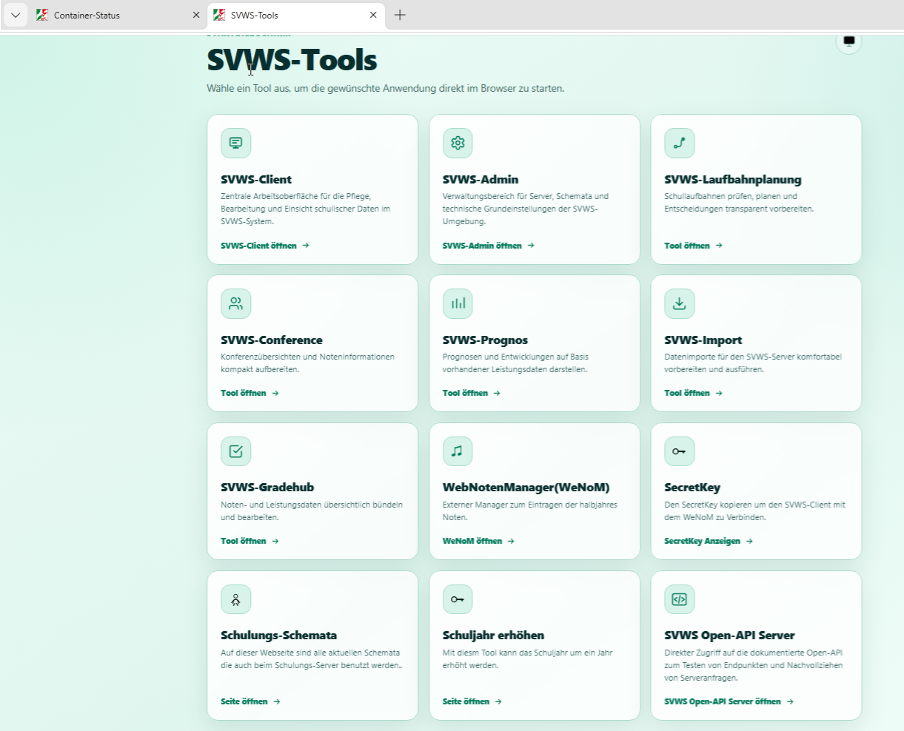

# Status und Link

Beim öfnen der Sete erscheint eine Tabbel mit allen installierten Docker-Containern aufgelistet.

In der Spalte *STACK* werden die jeweiligen Bezeichnunge der Container aufgelistet.

In der Spalte *SVWS-Tools* befindet sich die Schaltfläche *Anwendungen* mit dieser können die hinterlegten Tools für den jeweiligen Container in einem neuen Browserfenster angezeigt werden.

In den Spalten *SVWS-, MariaDB und WeNoM-Status* können die jeweiligen Container gestartet oder gestoppt werden. Als Zustandaanzeiger dienen ein grünes **An** für gestartet und ein rotes **Aus** für gestoppt.

### Links:

[Startseite](/docker/index.md)

[SVWS-Schemata-Update](/docker/index.md)

[SVWS-Versions-Update](/docker/svws-versions-update.md)

[Wenom-Versions-Update](/docker/wenom-versions-update.md)

[Schild-NRW-3](/docker/schild3.md)

[Status/Link](/docker/container-status.md)