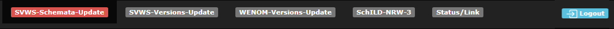

# Erklärungen zur Startseite (index.php)

## Die Schaltflächen

Bei der ausgewählte Seite ist die Farbe Rot und an der ersten Position.

## Der Seiteninhalt von SVWS-Schemata-Update

### Stausanzeige der Docker-Container.

Hier wird der erste und der letzte Container angezeigt. 

**STACK:**
pc-01 und darunter der letzte pc.

**SVWS-Status:**
Mit Start oder Stop können alle SVWS-Container gestartet oder bendet werden.

**WeNoM-Status:**
Mit Start oder Stop können alle WebNotenManager-Container gestartet oder bendet werden.

Die Anzeige ändert bei Start auf ein grünes An.

Die Anzeige ändert bei Stop auf ein rotes Aus.

### Zurücksetzen der Schulungs-Schemata

Durch betätigen der grauen Schaltflächen weden die jeweiligen Schemata bei allen Containern neu eingespielt.

### Links:

[Startseite](/docker/index.md)

[SVWS-Schemata-Update](/docker/index.md)

[SVWS-Versions-Update](/docker/svws-versions-update.md)

[Wenom-Versions-Update](/docker/wenom-versions-update.md)

[Schild-NRW-3](/docker/schild3.md)

[Status/Link](/docker/container-status.md)

