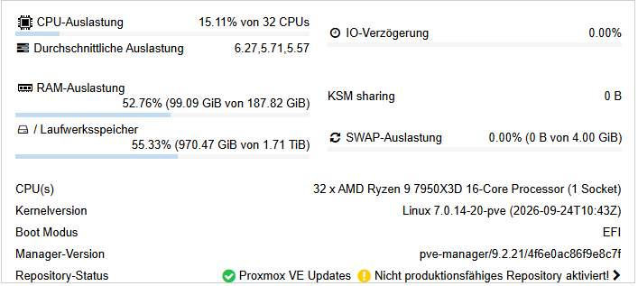
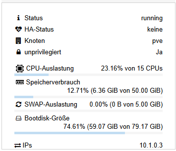
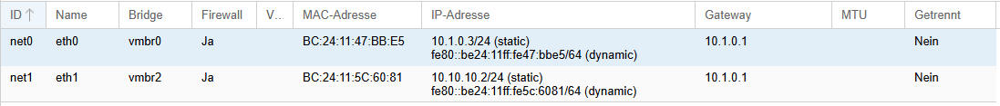

# Installation des Docker-Server

### Vorwort


Diese Installationsbeschreibung leht sich an einen installierten Proxmox auf einenm Hetzner Server mit 20 Windows 11 PCs




### Erstellen eines LXC-Containers: 

**15 CPUs, 50GB RAM, 5GB SWAP und 80GB Speicher**





### Docker-Server

```bash
ip a
wget InstallationsserverIP/INSTALL.sh
bash INSTALL.sh InstallationsserverIP
```

