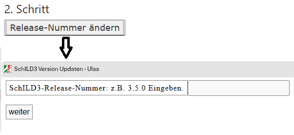

# Einspielen des neuen SchILD3.

## 1. Schritt

Über den Link *Setup_SchILD3_vx.x.xx.zip download* das neuste SchILD3 Release vom github Laden.

## 2. Schritt

Über die Schaltfläche *Release-Nummer ändern* das Formular öffnen.

## 3. Schritt

Durch Drücken von *SchILD3 Updaten* den Vorgang abschielssen.

### Links:

[Startseite](/docker/index.md)

[SVWS-Schemata-Update](/docker/index.md)

[SVWS-Versions-Update](/docker/svws-versions-update.md)

[Wenom-Versions-Update](/docker/wenom-versions-update.md)

[Schild-NRW-3](/docker/schild3.md)

[Status/Link](/docker/container-status.md)