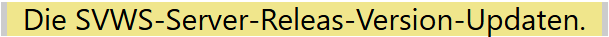
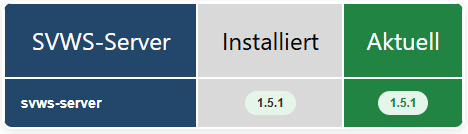
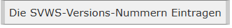
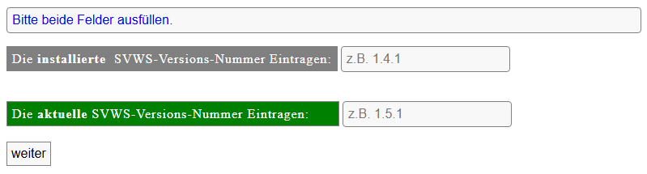
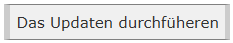

## 1. Schritt

In de Spalte **Aktuell** wird die neuste Realease Nummer angezeigt.

Durch drücken des Botton **Die SVWS-Versions-Nummern-Eintragen** öffnet sich das Formular zum Eintragen der Versionsnummern.

## 2. Schritt

Update auf das neuste Release des SVWS-Server durchführen.

### Links:

[SVWS-Schemata-Update](/docker/index.md)

[SVWS-Versions-Update](/docker/svws-versions-update.md)

[SVWS-Tools-Update](/docker/tools-versions-update.md)

[Schild-NRW-3](/docker/schild3.md)

[Status/Link](/docker/container-status.md)