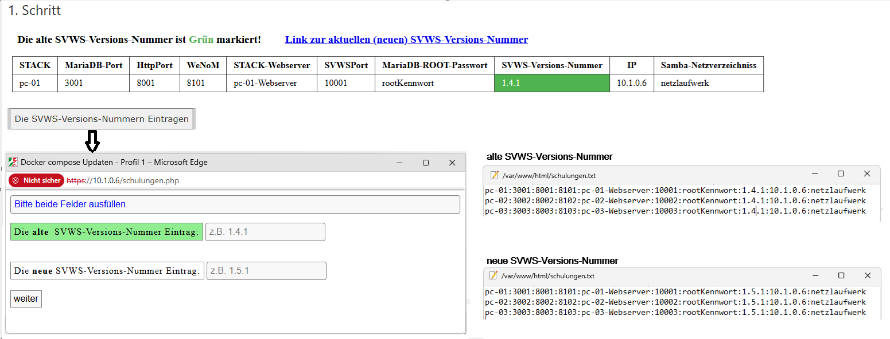
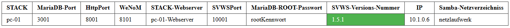

# Die SVWS-Server Releas Version Updaten

## 1. Schritt

Durch drücken des Botton die alte (Grüne) SVWS-Versions-Nummer durch die neue SVWS-Versions-Nummer in die Text-Datei <i>schulungen.txt</i> ersetzen. Nach drücken von weiter ändert sich die SVWS-Versions-Nummer in die neu eingetragene.

Hie die geänderte Tabellenansicht.

## 2. Schritt

Update auf das neuste Release des SVWS-Server durchführen.

### Links:

[Startseite](/docker/index.md)

[SVWS-Schemata-Update](/docker/index.md)

[SVWS-Versions-Update](/docker/svws-versions-update.md)

[Wenom-Versions-Update](/docker/wenom-versions-update.md)

[Schild-NRW-3](/docker/schild3.md)

[Status/Link](/docker/container-status.md)