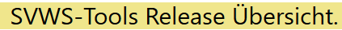
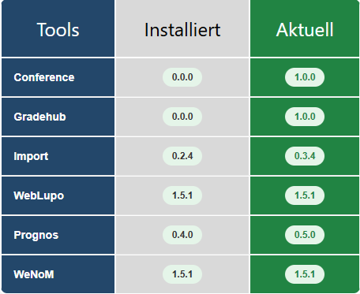
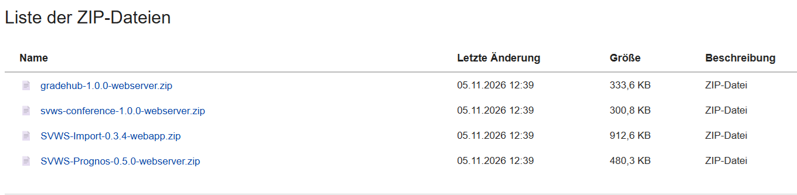
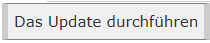
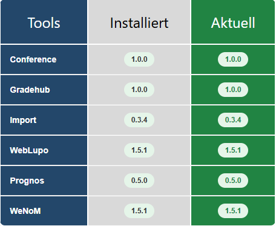

Wenn in der Tabelle der Wert für **Aktuell** höher ist als der für **Installiert** werden automatisch (Abfrage nur alle 24 Stunden möglich) die dem entsprchenden ZIP-Dateien iheruntergeladen.

Mit betätigen der Schaltfläche **Das Update durchführen** wereden die neuen Realeses eingpflegt die ZIP-Datein gelöscht und die neu Release-Nummer in die Tabelle eingetragen. 

Hinweis: *Bitte nach dem Update die Seite neu Laden!!*

### Links:

[Startseite](/docker/index.md)

[SVWS-Schemata-Update](/docker/index.md)

[SVWS-Versions-Update](/docker/svws-versions-update.md)

[SVWS-Tools-Update](/docker/tools-versions-update.md)

[Schild-NRW-3](/docker/schild3.md)

[Status/Link](/docker/container-status.md)