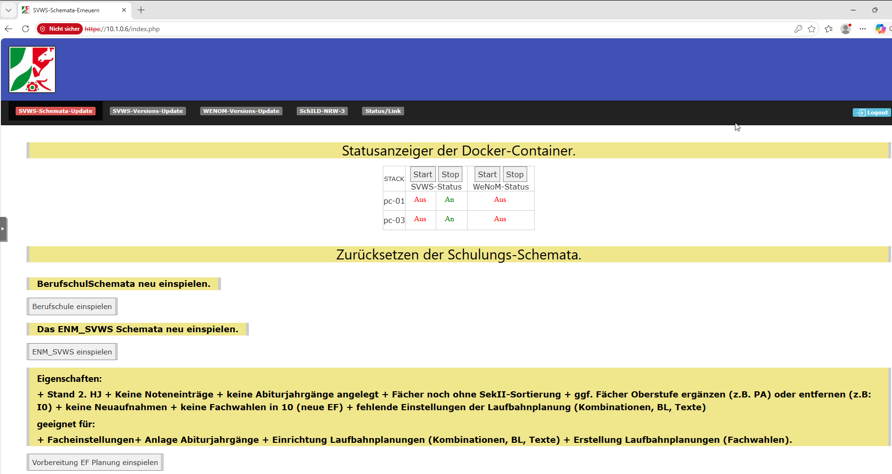

# Erklärungen zum Docker-Server

## Aufrufen der Startseite im Browser

Im Browser die Startseit aufrufen mit der Eingabe https:// gefolgt von der IP des Docker-Servers.

Benutzername: **fachberater**

Kennwort: **1tt....**

### Hinweis: 

Die Meldung **Nicht sicher** kann ignoriert werden da der Docker-Server nur im Intranet betrieben wird.

Nach eingabe des Benutzername und des Kennworts öffnet sich die Startseite.

### Links:

[Startseite](/docker/index.md)

[SVWS-Schemata-Update](/docker/index.md)

[SVWS-Versions-Update](/docker/svws-versions-update.md)

[Wenom-Versions-Update](/docker/wenom-versions-update.md)

[Schild-NRW-3](/docker/schild3.md)

[Status/Link](/docker/container-status.md)
