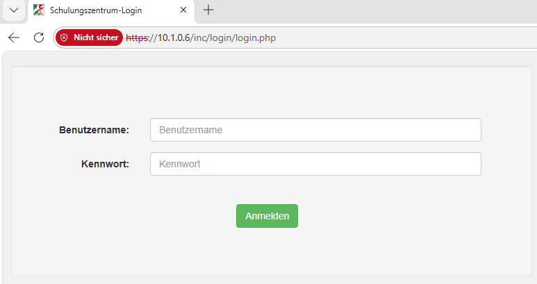

# Erklärungen zum Docker-Server

## Aufrufen der Startseite im Browser

Im Browser die Startseit aufrufen mit der Eingabe https:// gefolgt von der IP des Docker-Servers

### Hinweis: 

Die Meldung **Nicht sicher** kann ignoriert werden da der Docker-Server nur im Intranet betrieben wird.

