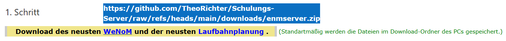
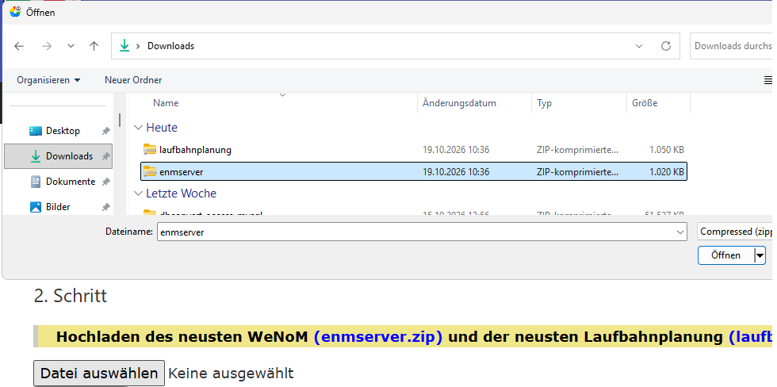
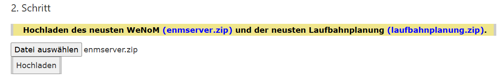

# WebNotenManger und Laufbahnplanung Updaten.

## 1. Schritt

Es werden die beiden Dateien **enmserver.zip** und **laufbahnplunung.zip** auf dem lokalen PC gespeichert.

## 2. Schritt

Mit der Schaltfläche *Datei auswählen* müßen die beiden Dateien **enmserver.zip** und **laufbahnplunung.zip** einzeln in das ZIP-Verzeichniss des Docker-Servers Kopiert

Durch Betätigung von *Öffnen* wird die Datei **enmserver.zip** ausgewählt und mit Drücken der Schaltfläche *Hochladen* kopiert werden.

Bitte den Vorgang mit der Datei **laufbahnplunung.zip** wiederhohlen.

## 3. Schritt

Mit der Schaltfläsche *Das Update durchführen* wird der WeNoM und die Laufbahnplanung auf den neusten Stand gebracht.

### Links:

[Startseite](/docker/index.md)

[SVWS-Schemata-Update](/docker/index.md)

[SVWS-Versions-Update](/docker/svws-versions-update.md)

[Wenom-Versions-Update](/docker/wenom-versions-update.md)

[Schild-NRW-3](/docker/schild3.md)

[Status/Link](/docker/container-status.md)