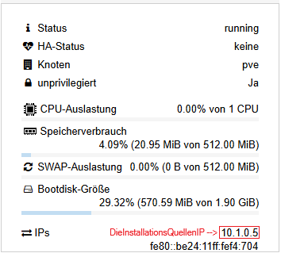

# Installation der Quelle und des Docker-Server

## Installation der Quelle

### Erstellen eines LXC-Containers: 

**1 CPU, 512MB RAM, 512 MB SWAP und 2GB Speicher**



### System Updaten und den Apache2 Webserver installieren:

```bash
apt update && apt upgrade -y && apt install apache2 mc ssh zip -y
```

Optional: Einstellen des deutschen Tastatur Layouts und der Zeitzone Europa/Berlin

```bash
dpkg-reconfigure locales && dpkg-reconfigure tzdata
```

### Installationsdaten holen, entzippen und löschen der ZIP-Datei:

```bash
cd /var/www/html
rm index.html
wget https://github.com/TheoRichter/Schulungs-Server/raw/refs/heads/main/downloads/SCHULUNGS-SERVER.zip
unzip SCHULUNGS-SERVER.zip
rm SCHULUNGS-SERVER.zip
ip a
```
Bitte merken Sie sich die IP des Installationsquelle.

