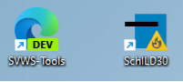
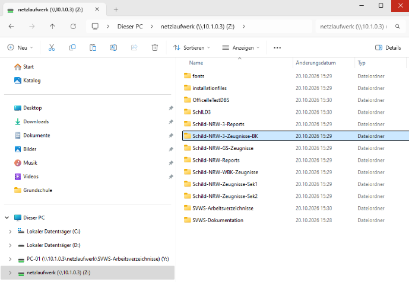
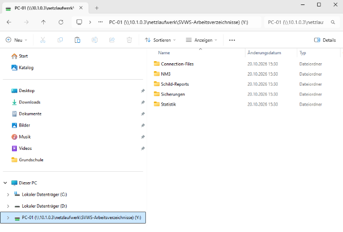

# Windows Desktop Icons und Netzlaufwerke

## Desktop Icons

Für die Schulungs-PCs bietet es sich an zwei Verknupfungen auf dem Desktop zu Platzieren.

## Netzlaufwerke

### Hinweis

Es kann sein das beim Einbinden der Netzlaufwerke nach einem Benutzername und dem Kennwort gefragt wird, das ist beides mal **smbuser**

Um einen reibungslosen Betrieb zu gewährleisten müßen zwei Netzlaufwerke eingebunden werde.

netzlaufwerk (\\docker*IP*) (Z:)

und

PC-01 (\\\docker**IP**\netzlaufwerk\SVWS-Arbeitsverzeichnisse)(Y:)

